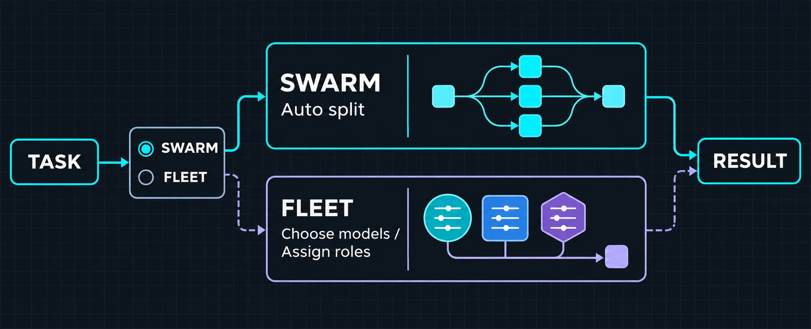

# kimi-swarm-pro

<p align="center">
  
</p>

A skill for [Kimi Code CLI](https://github.com/MoonshotAI/kimi-code). `/swarm` leaves the work to the CLI. `/fleet` stops and lets you choose the models.

> `/swarm` 走原生蜂群，`/fleet` 自己选模型和角色。

<p align="center">
  <a href="docs/assets/overview.webp">
    
  </a>
</p>

## Install

```bash
git clone https://github.com/SeanYuanWSY/kimi-swarm-pro.git
cd kimi-swarm-pro
./install.sh
```

You need git, Node 18 or newer, Python 3, and Kimi Code with at least two models in `~/.kimi-code/config.toml`. Python 3.11 or newer is the comfortable setup. The hook can use `tomli` on an older Python, but the API examples in the skill use `tomllib` and need 3.11.

This was written for Kimi Code around version 0.20. It has not been checked against newer CLI releases. `/swarm` is entirely the CLI's own command.

After it finishes, start a new Kimi Code session.

The script replaces these files if they already exist, and it does not keep the old copies:

- `~/.agents/skills/kimi-fleet/SKILL.md`
- `~/.kimi-code/scripts/kimi-fleet-hook.js`

It also links `~/.kimi-code/skills-curated/kimi-fleet` to the skill. If that path is already a normal file or directory, the script stops. It adds one hook to `~/.kimi-code/config.toml`, after saving `config.toml.kimi-fleet.bak.<timestamp>`.

A fleet that calls an API provider needs `curl` as well. The Ollama examples in the skill also need `ollama` and `perl`.

## Use

```text
/swarm 设计一个登录页面
```

The CLI splits this itself. The hook does not step in.

```text
/fleet 设计一个登录页面，前端模型负责UI，后端模型负责API
```

You pick the providers, models, and roles. The same questions start if you write something like `前端模型负责UI，后端模型负责API` without the slash command. A normal sentence that only mentions a model does not.

```bash
./uninstall.sh
```

This removes the skill, the link, the hook, and the hook entry. Backup copies of `config.toml` stay where they are.

## Demo

https://github.com/user-attachments/assets/61a58696-9cf0-4a22-a7c2-1f12eae1df9b

The recording is 105 seconds and ends on a generated 3D todo app. Names and local paths are covered. It shows an older session, not a test of the CLI you have now.

## Examples

- [A login page split across frontend, backend, and review](examples/example-frontend-backend.md)
- [Research split across three topics, then combined](examples/example-research.md)

## In this repo

| Path | What it is |
|---|---|
| `install.sh`, `uninstall.sh` | Setup and removal |
| `skills/kimi-fleet/` | The skill |
| `hooks/kimi-fleet-hook.js` | The prompt hook |
| `examples/` | The two walkthroughs |
| `docs/assets/` | Logo and diagram |

Changes and checks are in [Contributing](.github/CONTRIBUTING.md). Report a security problem through the [security policy](.github/SECURITY.md), not in a public issue.

MIT. Maintainer: [SeanYuanWSY](https://github.com/SeanYuanWSY).
