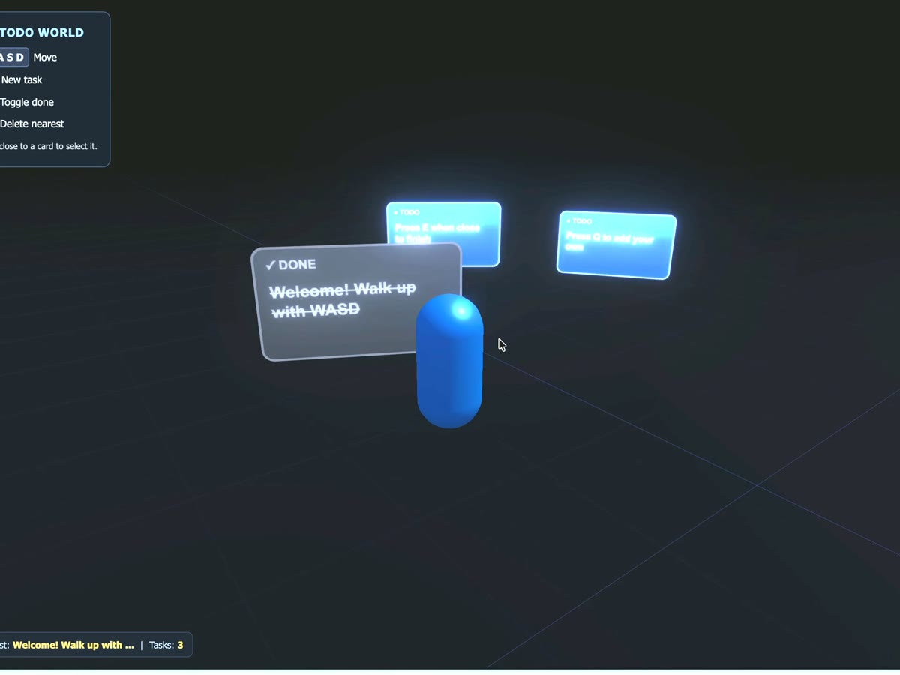

# kimi-swarm-pro

<p align="center">
  
</p>

A skill-and-hook extension for Kimi Code. The `kimi-fleet` skill lets you choose models, roles, and concurrency for a multi-model workflow. Kimi Code's native `/swarm` command remains available unchanged.

<p align="center">
  <a href="docs/assets/overview.webp">
    
  </a>
</p>

## Requirements

- [Kimi Code](https://github.com/MoonshotAI/kimi-code), with at least two models in `~/.kimi-code/config.toml`
- Git, Node.js 18 or newer, and Python 3
- Python 3.11 or newer is recommended. On older versions, install `tomli` so the hook can read TOML.
- `curl` for API providers. The Ollama examples also use `ollama` and `perl`.

Tested with Kimi Code around version 0.20. Newer CLI releases have not been verified.

## Install

```bash
git clone https://github.com/SeanYuanWSY/kimi-swarm-pro.git
cd kimi-swarm-pro
./install.sh
```

The installer adds the `kimi-fleet` skill, copies the prompt hook, and registers it under `~/.kimi-code/`. Existing skill and hook files are replaced without backups. It saves a timestamped backup before changing an existing `config.toml` and stops instead of replacing a normal file or directory at the skill-link path. See [How it works](docs/README.md#how-it-works) for the exact paths and extension boundary.

Start a new Kimi Code session after installation.

## Use

| Mode | What it does |
|---|---|
| `/swarm <task>` | Kimi Code splits the task itself. This project does not intercept it. |
| `/fleet <task>` | Confirm the task, then choose models, roles, and optional concurrency limits. |
| Natural language | A prompt assigning different models to different roles starts the same Fleet flow through the prompt hook. |

```text
/fleet 设计一个登录页面，前端模型负责UI，后端模型负责API
```

## Uninstall

```bash
./uninstall.sh
```

This removes the installed skill, link, hook, and hook registration. Configuration backups are kept.

## Preview

<p align="center">
  <a href="docs/README.md#fleet-walkthrough">
    
  </a>
</p>

See the [project guide](docs/README.md) for the complete Fleet walkthrough, both examples, and how the extension fits into Kimi Code.

## Repository layout

| Path | Contents |
|---|---|
| `skills/kimi-fleet/` | Fleet workflow and model-calling instructions |
| `hooks/` | Natural-language prompt hook |
| `install.sh`, `uninstall.sh` | Setup and removal |
| `docs/` | Project guide, walkthroughs, screenshots, and changelog |

## Status

Version `0.7.0`. This is a finalized snapshot for the author's own Kimi Code setup, not an actively maintained distribution. The detailed history is in the [changelog](docs/CHANGELOG.md).

[MIT license](LICENSE). [Security policy](.github/SECURITY.md).
