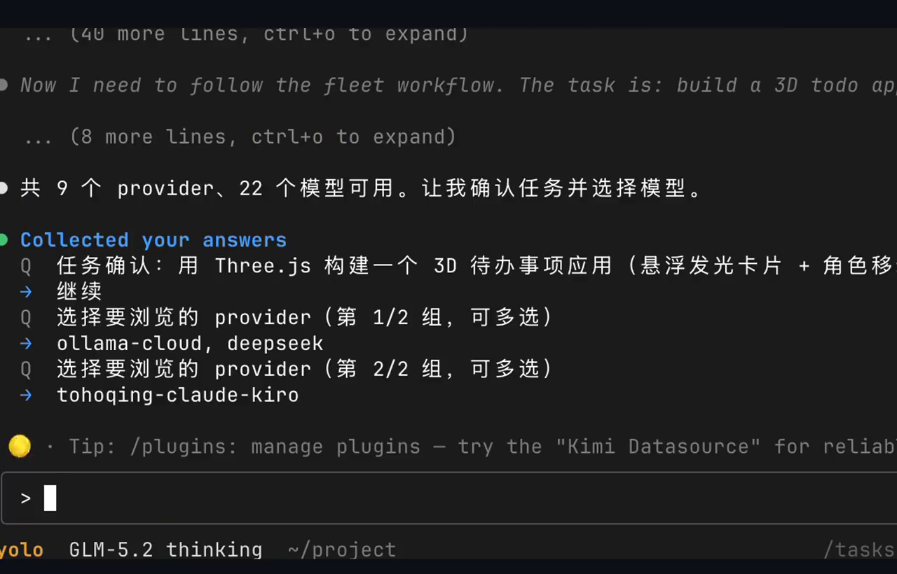
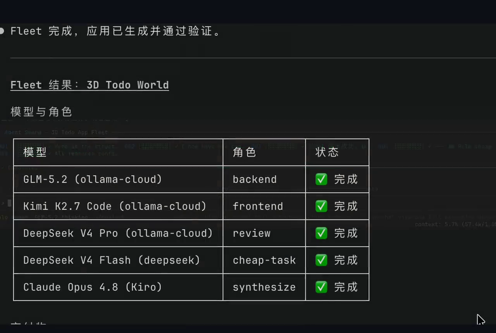
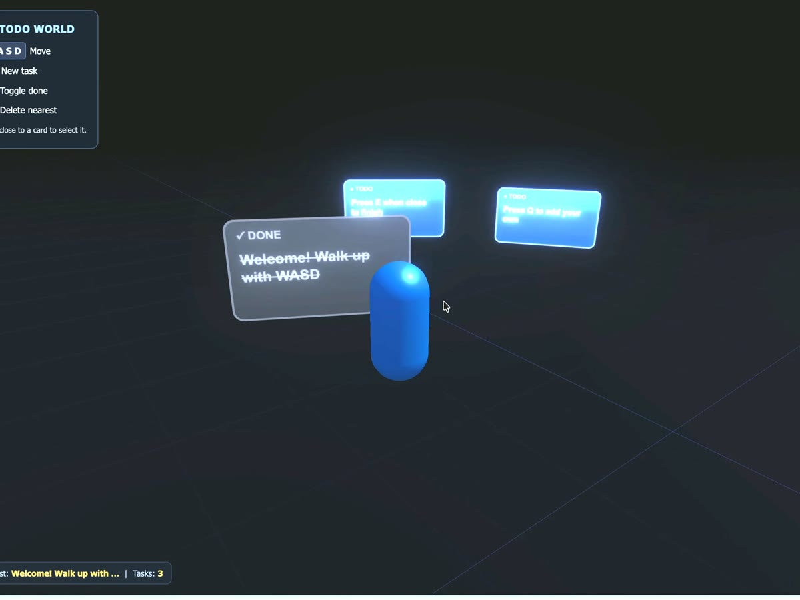

# Project guide

`kimi-swarm-pro` is the source repository. `kimi-fleet` is the Kimi Code skill it installs. Together, the skill and prompt hook provide a configurable multi-model Fleet workflow without replacing or forking Kimi Code.

## How it works

Kimi Code supplies the session, skill loading, hook execution, and AgentSwarm tool. This extension adds the Fleet instructions and an automatic entry for natural-language multi-role requests. `/swarm` remains a native Kimi Code command and is not intercepted.

```text
/fleet task
    -> Load the Fleet skill
    -> Confirm the task
    -> Choose providers, models, roles, and optional limits
    -> Build AgentSwarm items by dependency stage
    -> Run the assigned model through the skill's calling instructions
    -> Check reports and synthesize the results

Natural-language multi-role task
    -> UserPromptSubmit hook
    -> Read the configured provider and model list
    -> Return additional Fleet context to Kimi Code
    -> Follow the same skill workflow above
```

The hook adds context for the model to follow. It does not rewrite Kimi Code's executable or model-routing internals. Tasks assigned to different models use the model-calling instructions in the skill, not an unlisted model registry or a modified provider configuration.

## What the installer changes

| Source | Purpose | Installed location or effect |
|---|---|---|
| `skills/kimi-fleet/SKILL.md` | Fleet workflow and model-calling instructions | Copied to `~/.agents/skills/kimi-fleet/SKILL.md` |
| Installed skill | Makes the shared skill visible to Kimi Code | Linked from `~/.kimi-code/skills-curated/kimi-fleet` |
| `hooks/kimi-fleet-hook.js` | Detects eligible natural-language prompts and supplies Fleet context | Copied to `~/.kimi-code/scripts/kimi-fleet-hook.js` |
| Hook registration | Runs the hook for `UserPromptSubmit` | Appended to `~/.kimi-code/config.toml` with a marker |

An existing installed skill or hook file at these locations is replaced without a backup. The installer saves a timestamped backup before changing an existing `config.toml`. If the curated skill path is a normal file or directory rather than a symlink, installation stops instead of replacing it. It does not modify the Kimi Code source tree.

## Fleet walkthrough

### 1. Confirm the task and choose providers

Fleet reads the actual model configuration before asking which providers to use.



### 2. Assign models and roles

Each selected model receives a responsibility. The summary reports its role and completion status.



### 3. Inspect the result

This demonstration ends with a working 3D todo app built by the fleet.



The screenshots were recorded with Kimi Code around version 0.20. Newer CLI interfaces may look different.

## Examples

- [Frontend, backend, then review](examples/example-frontend-backend.md)
- [Three research tasks, then synthesis](examples/example-research.md)

## Project records

- [Changelog](CHANGELOG.md): feature, compatibility, and fix history.
- [Development notes](../.github/CONTRIBUTING.md): repository checks and safe installer testing.
- [Security policy](../.github/SECURITY.md): supported version and private reporting contact.
